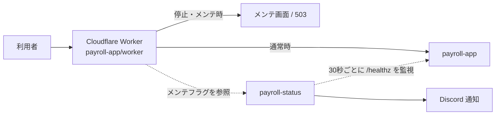

# payroll

個人指導塾の講師向け給与計算アプリと、そのステータスページをまとめたリポジトリです。

| ディレクトリ | 中身 |
| --- | --- |
| [`payroll-app/`](./payroll-app) | 給与計算・シフト管理アプリ本体（React + Express + SQLite の npm workspaces）と、前段の Cloudflare Worker |
| [`payroll-status/`](./payroll-status) | ステータスページ・死活監視・Discord 通知・メンテナンスフラグの管理 |

## 全体の構成

- 利用者のアクセスはすべて Worker を通ります。Worker は payroll-status の `/api/maintenance-status` を見て、停止中やメンテナンス中はアプリへ流さずメンテ画面を返します
- payroll-status はアプリの `/healthz` を監視し、落ちたら自動でメンテ表示に切り替えてステータスページと Discord に投稿します

それぞれの起動方法は各ディレクトリの README を参照してください。

## ライセンス

[MIT](./LICENSE)。同梱の Noto Sans JP フォントは SIL Open Font License 1.1 です。
